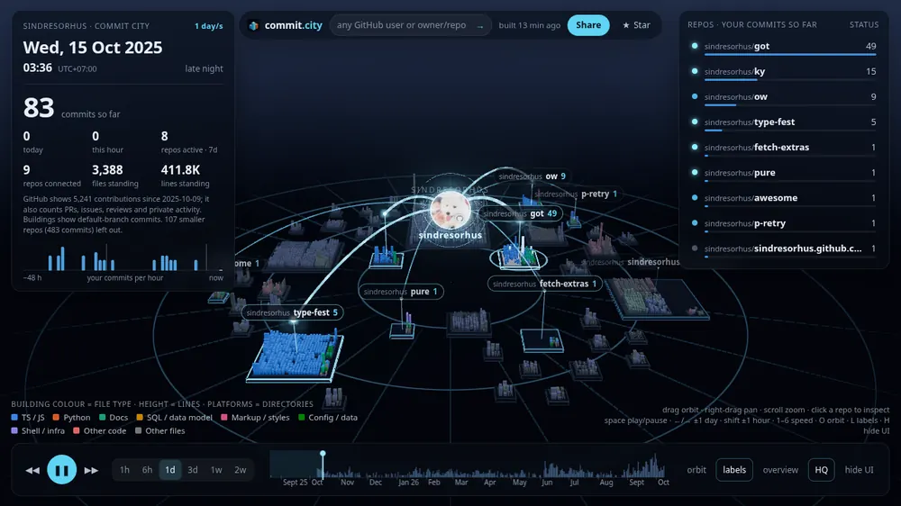

<div align="center">

<a href="https://commit.city/sindresorhus"></a>

# commit.city

**Your GitHub, as a living city.**<br>
Swap `github.com` for `commit.city` on any user, org or repo and watch a year of git history replay,
commit by commit, as a 3D city you can scrub, fly through and share.

[**Open commit.city →**](https://commit.city) &nbsp;·&nbsp; [GitHub, live](https://commit.city/events) &nbsp;·&nbsp; [Agent lens](#humans-bots-and-ai-agents) &nbsp;·&nbsp; [README card](#put-it-on-your-profile) &nbsp;·&nbsp; [Private repos](#private-repos-run-it-yourself) &nbsp;·&nbsp; [How it works](#how-it-works)

[](https://commit.city)
[](https://github.com/azank1/commit-city/actions/workflows/ci.yml)
[](LICENSE)
[](https://github.com/azank1/commit-city/stargazers)

</div>

## Try it: swap the domain

| On GitHub | On commit.city | What you get |
|---|---|---|
| `github.com/torvalds` | [`commit.city/torvalds`](https://commit.city/torvalds) | a person's year: every public repo they committed to, wired to their avatar |
| `github.com/vercel` | [`commit.city/vercel`](https://commit.city/vercel) | an org: its 24 busiest repos with everyone's commits |
| `github.com/facebook/react` | [`commit.city/facebook/react`](https://commit.city/facebook/react) | one repo, every contributor |
| | [`commit.city/denoland/deno?all=1`](https://commit.city/denoland/deno?all=1) | a repo's entire history, from the first commit |

There's no sign-up and nothing to install. The first visit builds the city while you watch, repo by repo. That takes a few seconds for a small account and a few minutes for a big one. After that it's cached and opens instantly for everyone.

## Reading the city

- **Islands are repos.** Each one is a squarified treemap of its tree. An org's repos cluster into sectors.
- **Platforms are directories**, stacked by depth.
- **Towers are files.**
  - Height is line count and colour is file type.
  - Footprints stay put, so you can watch a single file grow, shrink, move or disappear.
- **Beams are commits.** Each one flies from the avatar to the island it lands on, and the files it touched flash.
- **Repos cool as they go quiet:** hot → active → cooling → dormant → abandoned. The connection to an abandoned repo thins to a thread.
- **The clock is yours.** Days and nights follow the timezone you actually commit in, read from your own commits.

| Input | Action |
|---|---|
| drag · right-drag · scroll | orbit · pan · zoom |
| click a repo (or a leaderboard row) | inspect it; Esc goes back |
| drag the timeline | scrub anywhere |
| Space · ←/→ · Shift+←/→ | play/pause · ±1 day · ±1 hour |
| 1–6, ↑/↓ | speed: 1 hr/s … 2 wk/s |
| A | the agent lens: colour every commit by human, bot or AI agent |
| R | record a clip of the year (MP4 or WebM, 16:9, 9:16 or 1:1) |
| Home / End · O · L · H · F | start/now · auto-orbit · labels · hide UI · focus hovered repo |

Every view can be linked. **Share → copy this moment** gives you a URL that reopens at the same time with the same camera, for example:

```
https://commit.city/you#t=2026-03-14T21:30&speed=1h&play=1&focus=<repo>&orbit=0&hud=0&lens=agents
```

When the replay reaches today, the city keeps listening: new public pushes, pull requests and releases fly in as beams while the page is open.

## Humans, bots and AI agents

More and more commits are written by AI agents and automation. Press **A** in any city and every beam takes the colour of whoever sent it: people in cyan, bots in amber, and each agent in its own colour. The clock panel breaks the city down by author, the leaderboard splits each repo, and the timeline stacks each day.

A commit is classified from the signatures it carries, in this order:

1. **Its author.** Agents that commit as themselves, like `copilot-swe-agent[bot]` or `devin-ai-integration[bot]`.
2. **Its message.** A `Co-authored-by:` trailer (Claude Code, Cursor, Copilot and others add one) or a footer such as *Generated with Claude Code*, or Aider's `aider:` prefix.
3. **Bots.** Any `[bot]` account, plus dependabot, renovate, github-actions and friends.

Everything else counts as human. Agent work that isn't disclosed looks human, so the split is a floor, not an audit. The rules for 17 agents live in one file, [`schema/agents.json`](schema/agents.json), which the Python CLI and the hosted builder share and both test suites check. Adding an agent is a pull request to that file.

[**commit.city/events**](https://commit.city/events) applies the same lens to all of GitHub: the public timeline, a few minutes behind real time, as a city of repos that rise and sink as events arrive. It splits people, bots and agents, using account names and agent branch names such as `claude/…` or `copilot/…`.

## Put it on your profile

<a href="https://commit.city/sindresorhus"></a>

```md
[](https://commit.city/YOU)
```

The card is a self-contained SVG, so it renders through GitHub's image proxy. Its towers rise as it loads.

| Option | Effect |
|---|---|
| `&theme=light` | light theme |
| `&animate=0` | no rise animation |
| `&all=1` | the whole-history city of a repo |

Every city also gets a link preview, so pasting `commit.city/you` into Slack, X, Discord or LinkedIn unfurls into its skyline.

**Clips.** Press **R** (or **Share → Record a clip**) and the year replays in 10, 20 or 30 seconds while the camera orbits. The browser records it as a video, wide for X and LinkedIn or vertical for Reels and Shorts. Nothing is uploaded.

**Embeds.** `<iframe src="https://commit.city/you#embed=1">` puts a live city on your own site. Inside an embed the mouse wheel scrolls your page until the city is clicked; add `&hud=0` for just the city. The [card builder](https://commit.city/readme) writes the snippets for you.

## Privacy and control

- **Public data only.** The hosted builder reads public repos with a read-only token that cannot see anything private. Private repos never appear on commit.city.
- **You can opt out.**
  - Sign in with GitHub to exclude repos from your city or to hide it completely. Hiding deletes it and keeps it from being rebuilt.
  - Sign-in asks for no scopes. It proves who you are, and builds you start then use your own GitHub API quota instead of the shared one.
- **No ads, no trackers.** No cookies are set unless you sign in. A city is a cached public file built from public commits, nothing more.

## Private repos? Run it yourself

The same pipeline ships as a **GitHub Action** and a **stdlib-only Python CLI**. Either one writes one offline HTML file (three.js, your data and your avatar all inlined) that you can host anywhere.

They can include private repos, which are opt-in and always anonymised:

- private repos show as `private/repo-N`;
- every directory and file is renamed (`dir3/file17.ts`);
- sizes and commit timing stay real.

**Template + Action** (five minutes of clicking; the Action does the rest):

1. Click **Use this template** and create a repo under your account (any name).
2. In the new repo, set **Settings → Pages → Source** to **GitHub Actions**.
3. Run **Actions → commit-city → Run workflow**. After that it re-runs every week and only re-reads repos that moved.
4. Open `https://<you>.github.io/<repo>/`.

To include private repos:

- set `include_private = true` in [`commit-city.toml`](commit-city.example.toml);
- add a fine-grained PAT with read-only *Contents* and *Metadata* as the `COMMIT_CITY_TOKEN` secret.

Already have a workflow? Use the Action directly: `uses: azank1/commit-city@v0` ([inputs](action.yml)).

**CLI** (Python 3.11+ and git, no dependencies):

```bash
pipx install git+https://github.com/azank1/commit-city
commit-city build --login YOU --out my-city.html                      # public repos
GH_TOKEN=... commit-city build --login YOU --include-private            # plus private ones, anonymised
```

The CLI uses `GITHUB_TOKEN`, `GH_TOKEN` or your `gh` login. Clones are deleted as soon as each repo has been read. Tokens reach git through the environment, never the command line.

## How it works

Two builders produce one versioned payload ([`schema/lapse.schema.json`](schema/lapse.schema.json)), and one three.js viewer renders it.

```
            ┌─ hosted (web/, TypeScript, serverless) ─┐
discover ──►│ replay over git's own wire protocol      │──► bundle ──► payload ──► viewer
GraphQL     ├─ offline (commit_city/, Python + git) ───┤    rules       (gz JSON)    three.js
            │ replay over a bare clone                 │
            └──────────────────────────────────────────┘
```

**The hosted builder** runs as Vercel Functions with no `git` binary and no disk:

1. **Discover.** GraphQL finds who the target is, which repos to draw and the window. Windows are whole UTC days, so builds share work.
2. **Replay.** Each repo gets its own function call.
   - **Protocol:** it speaks git's smart-HTTP **protocol v2** directly, using `fetch` with `deepen-since` to pull just the year's commits.
   - **Partial fetch:** `filter blob:limit=128k` holds back big blobs. Binaries are recognised by name. Big text files arrive together in one follow-up fetch.
   - **Parser:** a small pack parser (zlib + deltas) and a tree differ replay the first-parent history, tracking every file's existence and line count.
3. **Cache.** Repo records are keyed by head commit, so every later city that includes the repo reuses them. The same repo in your city, your org's city and a friend's city is read once.
4. **Bundle and publish.** The bundle step applies the same rules as the Python bundler. The payload is gzipped to Blob storage, along with a skyline used for the cards and link previews.
5. **The browser drives the build:** start, then one call per repo (four at a time), then finish. A big account never runs into one function's time limit, and you get to watch it come together.

**Parity is tested.** The TypeScript engine is checked against the Python replay, which uses a real `git clone` and `numstat`.

- **Offline:** synthetic repos covering renames, merges, symlinks, binaries, `.gitattributes` and timezones.
- **Live:** real repos such as vite, svelte, express and click.
- **What must match:** the same files, line counts and touch lists.

**The offline builder** (`commit_city/`) runs the same four steps:

1. GraphQL `contributionsCollection` with a REST fallback;
2. a bare single-branch clone per repo;
3. a numstat replay of first-parent history;
4. render into the prebuilt viewer template.

### Rules that make any account fit

| Rule | Hosted (commit.city) | CLI / Action default |
|---|---|---|
| Window | the last 365 days, or everything with `?all=1` on a repo | `since`, 365 days |
| People | top 50 repos by your commits | top 60 (`max_repos`) |
| Orgs | the 24 busiest repos | n/a |
| Repo size | up to ~1.5 GB on disk | no limit |
| Big repos | the deepest folders fold into one building until the repo fits 2,500 files (60,000 across the city) | same |
| Skipped paths | `node_modules`, `dist`, `vendor`, venvs, caches, lockfiles, `*.min.js`, `*.map` | same |
| Binary files | count as 12 lines | same |
| Commits vs contributions | buildings show default-branch commits; the HUD shows GitHub's contribution total next to them, because that total also counts PRs, issues, reviews and private activity | same |

## Run the site yourself

commit.city is this repo's [`web/`](web) directory deployed as-is. Setup, environment and costs are in [`web/README.md`](web/README.md).

## Develop

```bash
python3 -m unittest discover -s tests                          # Python pipeline, offline
cd web && npm ci && npm test                                   # hosted engine, incl. parity with the Python replay
cd web && GITHUB_TOKEN=$(gh auth token) node scripts/dev.mjs   # the whole site on localhost:3000
cd viewer && npm ci && node build.mjs                          # after viewer edits: rebuild both viewer outputs
node web/scripts/site.mjs                                      # after edits to web/site/*.html: regenerate the site pages
node schema/sync.mjs                                           # after edits to schema/agents.json: copy the rules to both builders
```

The viewer is plain three.js in `viewer/src`:

- `layout.js` builds the treemap cities and org sectors;
- `shaders.js` draws the crisp edges, the glow and the beams;
- `main.js` runs the simulation, HUD, agent lens, recorder and controls;
- `selftest.js` holds the interaction checks (open any city with `#selftest=1`);
- `season.js` is the Halloween look: on 31 October (the visitor's own date) GitHub's Halloween graph colours, a moon, bats, and a ghost for every file deleted. `#theme=halloween` shows it any day, `#theme=plain` turns it off;
- `live.js` and `live-selftest.js` are commit.city/events (`/events#selftest=1`, or `#demo=1` for a synthetic feed).

The site's pages are written in `web/site/` (shared head, nav and footer partials, one file per page) and generated into `web/public/` by `web/scripts/site.mjs`. CI fails if a generated file is out of date.

Issues and PRs are welcome.

## Credits

MIT © [azank1](https://github.com/azank1).

- Built on [three.js](https://threejs.org), the [Inter](https://rsms.me/inter/) and [JetBrains Mono](https://www.jetbrains.com/lp/mono/) typefaces (OFL) and [resvg](https://github.com/RazrFalcon/resvg).
- Inspired by every "github.com → something.com" tool that made a repo one URL away.
